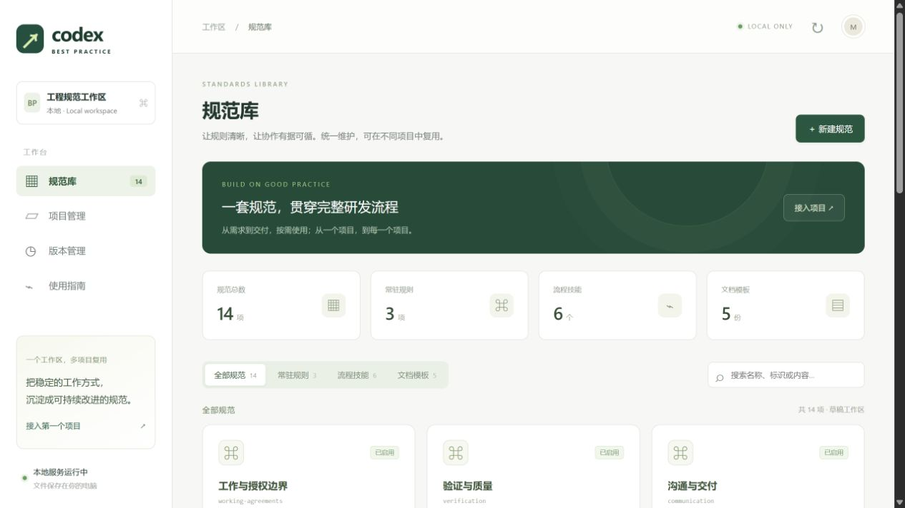

# Codex Best Practice

一套可以带到其他项目的 Codex 工程规范：**规则 + 六个流程技能 + 文档模板 + 接入升级工具 + 本地管理台**。

目标是让需求、范围、实现、验证与交付保持可控，同时让小任务保持轻量。支持 Windows、macOS、Linux；运行环境为 **Python 3.11+**，无需 pip、Node.js、数据库或 API Key。

## 在其他项目里使用：复制这段话

在另一个项目打开 Codex，将下面提示词发给它。当前电脑可直接复制；其他电脑先克隆本仓库，再替换其中的工具仓库路径。

```text
请读取 C:/Users/matth/Desktop/codexbestpratice/.agents/skills/bp-setup/SKILL.md，
为当前项目接入 Codex Best Practice。
使用推荐配置，先展示实际文件差异，再由我一次确认后应用。
保留已有规则与本地修改；未知验证命令标记为待补充。
```

希望逐项设置时，将“使用推荐配置”换成：

```text
请采用引导设置，依次确认项目名称、技术栈、验证命令、修改边界和启用规范，
最后统一展示文件差异，由我一次确认后应用。
```

**工具仓库与业务项目是两个目录。** 保留工具仓库供接入与后续升级使用，业务项目只接收自己的规则、技能、模板及接入记录。无需复制整套管理台。

首次在另一台电脑准备工具仓库：

```bash
git clone https://github.com/matthewdailytools/codexbestpratice.git
```

## 启动规范管理界面

在本仓库执行：

```bash
python scripts/codex_bp.py serve --open
```

也可从任意目录使用脚本绝对路径。服务自动选择空闲端口并打开浏览器，终端显示实际地址；按 `Ctrl+C` 停止。macOS/Linux 如果命令名为 `python3`，将示例中的 `python` 换成 `python3`。



管理台提供：

- **规范库**：搜索、新建、编辑、启用或停用常驻规则、Skills 和模板。
- **规范编辑**：设置表单 + Markdown 正文、实时预览、保存前差异。
- **项目管理**：登记本地目录，快速接入或引导设置，修改配置、检查状态和预览升级。
- **版本管理**：查看草稿差异、创建不可覆盖的版本、查看历史和复制历史内容为新草稿。
- **使用指南**：复制自动带入本机工具仓库路径的接入提示词。

在“项目管理”输入另一个项目的已有目录，点击“登记项目”。登记仅记录本机路径，随后点击“一键确认接入”或“引导设置”，检查差异后确认应用。

## 接入后会得到什么

```text
你的项目/
├── AGENTS.md                    # 在原文件中添加受管区块，保留原内容
├── .agents/skills/bp-*/SKILL.md   # 六个按需使用的技能
└── .codex-bp/
    ├── project.json             # 项目自己的配置，升级时保留
    ├── lock.json                # 接入版本与受管内容哈希
    └── templates/*.md           # 五类文档模板
```

这些文件可随业务项目提交到版本库，供团队使用。本机项目登记路径在工具仓库 `.local/` 内，已加入 Git 忽略。

`AGENTS.md` 在新会话中加载；Skills 通常自动发现。如未出现，重新打开该项目的 Codex 会话。存在非空 `AGENTS.override.md` 时，工具会提示其遮蔽问题并停止接入。

## 日常使用

小任务直接描述目标即可，不必按顺序调用所有技能。复杂任务或特定流程可以明确调用：

| 入口 | 用途 | 提示词示例 |
| --- | --- | --- |
| `$bp-plan` | 需求澄清、规划 | 为订单导出功能明确范围、验收与实现计划 |
| `$bp-implement` | 实现与验证 | 按已确定计划完成导出并验证 |
| `$bp-review` | 变更评审 | 评审当前差异，优先找可复现缺陷 |
| `$bp-handoff` | 交付、续接 | 整理当前任务状态、验证与剩余工作 |
| `$bp-retro` | 复盘、规范改进 | 根据这次实际问题提出最小规范改进 |
| `$bp-setup` | 接入、配置、升级 | 使用工具仓库预览本项目规范升级 |

自动识别的验证命令默认 `confirmed: false`。它表示命令入口尚待核实，不表示执行失败；`confirmed: true` 也不表示测试通过。接入、升级、管理台启动均不会执行项目命令。

## 后续修改与升级

1. 在规范库修改正文或元信息，预览并保存草稿。
2. 在版本管理查看草稿差异并创建新版本；初始版本为 `0.1.0`。
3. 在项目管理选择“预览升级”，检查差异后确认应用。

也可以在业务项目对 Codex 说：

```text
使用位于 C:/Users/matth/Desktop/codexbestpratice 的工具仓库，
为当前项目预览 Codex Best Practice 规范升级，展示差异后由我确认应用。
保留项目配置和已有本地修改。
```

GitHub 有更新时，在工具仓库确认本地工作区状态后正常拉取。目标项目的规则不会因此自动变化，仍需显式预览升级。

**需要项目专属约定**：优先通过“修改配置”填写修改边界，或写入 `AGENTS.md` 受管区块之外。直接修改受管 Skills、模板或受管区块会被识别为本地冲突；请先将差异移入项目约定或共享草稿，再重新预览。工具不提供强制覆盖。

## 命令行使用

```bash
# 只读预览；--out 必须放在目标项目之外
python scripts/codex_bp.py preview --operation init --target /path/to/project --out /tmp/bp-plan.json

# 核对计划中的 conflicts、config 与 changes，确认后应用
python scripts/codex_bp.py apply --plan /tmp/bp-plan.json

# 检查接入状态
python scripts/codex_bp.py check --target /path/to/project

# 预览升级；只调整配置时 operation 使用 configure
python scripts/codex_bp.py preview --operation upgrade --target /path/to/project --out /tmp/bp-upgrade.json

# 从草稿创建本地不可变版本；不会执行 git commit 或 push
python scripts/codex_bp.py release --version 0.1.1
```

Windows 可将 `/tmp/bp-plan.json` 替换为 `$env:TEMP/bp-plan.json`；包含空格的路径加引号。使用 `--settings` 传入 [项目配置示例](examples/project-settings.json)，可省略无需覆盖的字段。退出码 `0` 表示成功，`2` 表示冲突、待接入或输入问题，`1` 表示 I/O 等执行失败。

## 文档与验证

- [完整工程实践](BEST_PRACTICES.md)
- [开发与接口说明](DEVELOPMENT.md)
- [验证记录与实际限制](VALIDATION.md)

```bash
python -m unittest discover -s tests -v
```

后端与 CLI 只使用 Python 标准库。前端随包提供 `markdown-it 15.0.3`，运行时不连接 CDN，原始 HTML 不执行；第三方许可证及来源记录在 `web/vendor/`。
