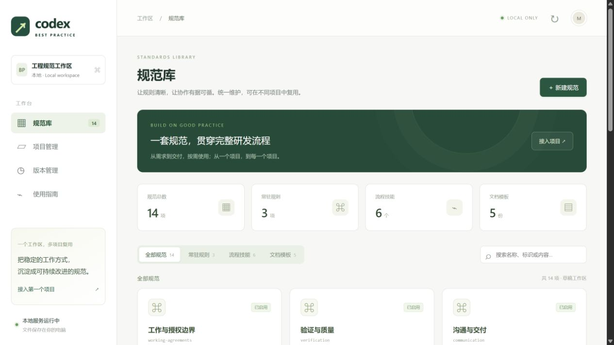

# 验证记录

验证日期：2026-11-13（Asia/Shanghai）。验证环境：Windows、Python 3.11.9、Codex CLI 0.142.1；JavaScript 语法检查使用 Node.js 25.1.0。

## 自动化检查

执行 `python -m unittest discover -s tests -v`：**29 项通过，无跳过**。

覆盖：

- 空目录、已有 AGENTS.md、中文与空格路径，TypeScript 与 Python 技术栈识别。
- 预览不写入、重复接入幂等、已有规则及 BOM／换行保留。
- 同名文件与同名 Skill 目录冲突、非空 override 遮蔽保护。
- 受管文件或区块被修改、预览后目标变化、计划被修改、快照被修改时停止。
- 升级保留项目配置与任务记录、停用规范仅在升级后移除。
- 固定已预览版本、新版本创建不会静默改变既有计划。
- 模拟磁盘故障，恢复原文件并清理本次新建内容。
- 版本不可覆盖、编辑 etag 冲突、历史内容恢复为草稿。
- 路径穿越及符号链接越界、未知目标、Host／Origin／会话令牌检查。
- 从工具仓库以外的工作目录调用真实 CLI 完成预览、应用与检查。
- 自动识别的命令保持待确认，接入过程不执行项目命令。

另通过：Python 编译检查、`node --check web/app.js`、`git diff --check`。

规范快照通过 Git 索引导出检查：在 `core.autocrlf=true` 设置下导出后，初始版本哈希与草稿状态仍一致。仓库通过 `.gitattributes` 固定文本换行，并禁止转换版本快照字节；新增版本统一使用 LF，草稿比较忽略纯换行差异。

## Skills 校验与实际发现

六个源 Skills 均通过本机 Codex `skill-creator/scripts/quick_validate.py` 元数据校验，安装后引用的模板路径检查通过。

在工具仓库之外创建独立临时 Git 项目，使用真实接入工具安装，再通过 **Codex CLI app-server 的 `skills/list`** 重新扫描。六个 Skills 均被实际识别，scope 为 `repo`，enabled 为 `true`：

- bp-setup
- bp-plan
- bp-implement
- bp-review
- bp-handoff
- bp-retro

该检查只读取技能发现结果，没有启动模型任务或修改全局配置。对小任务、复杂任务和缺少验证命令的流程说明另做了静态审阅；未进行模型多轮行为评估。

## 浏览器完整流程

使用隔离规范库和临时 JavaScript 项目完成：

1. 查看规范分类与实时 Markdown 预览。
2. 编辑工作约定，预览差异并保存草稿。
3. 从草稿创建 0.1.1 本地版本。
4. 登记已有 AGENTS.md 的项目，查看快速接入推荐配置与实际文件差异。
5. 一次确认后接入，页面显示已接入及待确认验证命令。
6. 通过四步引导修改项目名称和边界，预览并确认配置变更。
7. 修改第二版规范并创建 0.1.2，项目保持原版本直到确认升级。
8. 预览升级只改变 AGENTS.md 和接入记录；确认后项目显示 0.1.2，原有规则和项目配置保留。

流程结束时浏览器控制台无错误。浏览器验收发现并修复了表单 `id` 字段影响提交识别的问题。

检查了桌面 1365×900 和默认窄视图布局；临时视口覆盖已恢复。实际工具仓库保留纯净的初始 0.1.0，浏览器测试版本和登记路径位于被 Git 忽略的临时目录。

管理台预览：

## 实际边界

- 本次实际执行环境为 Windows；macOS、Linux 尚未实机运行，使用的核心文件与网络接口均为 Python 跨平台标准库。
- 文件恢复针对可捕获的写入异常；强制终止、断电与跨进程同时写入的限制见 DEVELOPMENT.md。
- 管理台只面向本机使用；没有云部署、账号或多人权限系统。
- 临时测试数据、本机登记路径及会话令牌不纳入提交。
